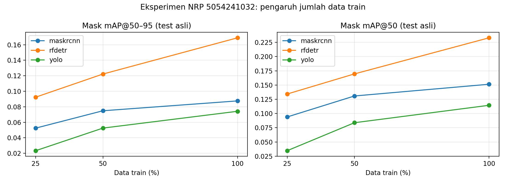
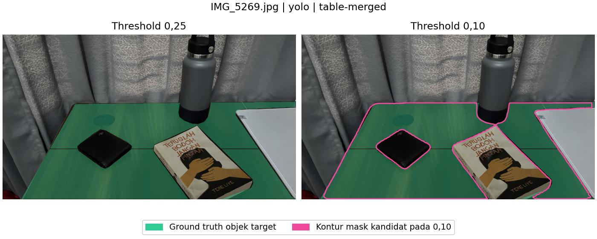
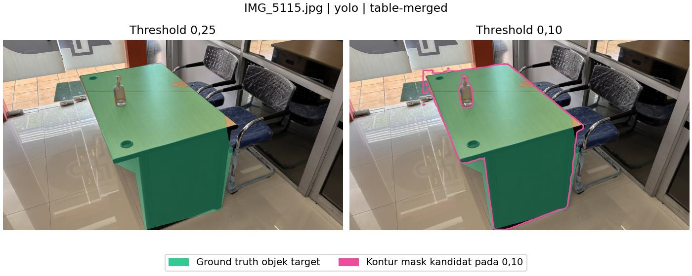
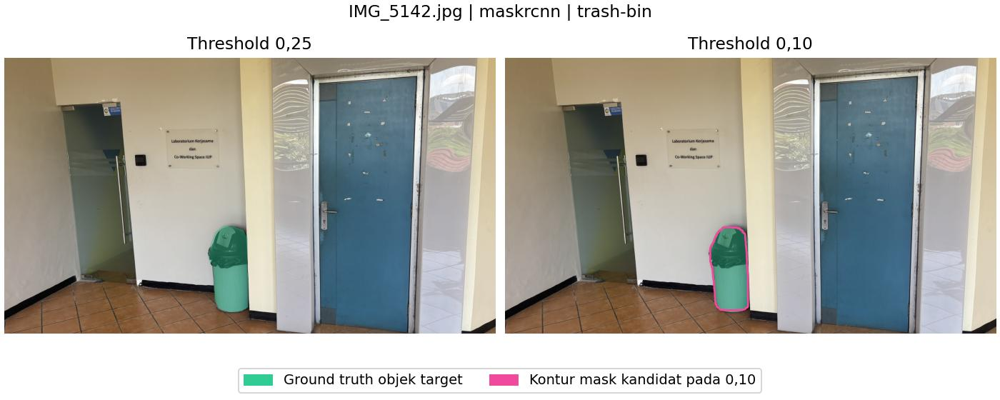
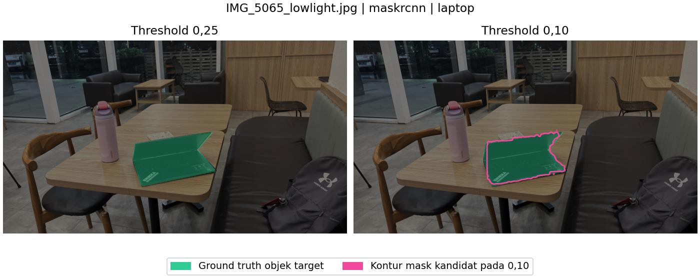
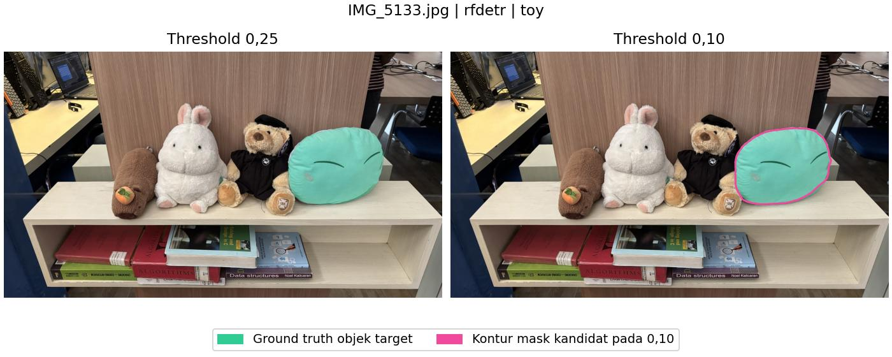

# Laporan Akhir Visi Komputer

## Perbandingan Mask R-CNN, YOLO26s-seg, dan RF-DETR-Seg untuk Segmentasi Instance Ruangan Indoor

**Seifeldein Akbar · NRP 5054241032**  
**Visi Komputer · Evaluasi CPMK 3 · 25 November 2026**

## Abstrak

Eksperimen ini membandingkan tiga model segmentasi instance pada foto ruangan indoor dan menguji pengaruh jumlah data latih. Mask R-CNN R50-FPN, YOLO26s-seg, dan RF-DETR-Seg Medium dilatih pada 25%, 50%, dan 100% data latih Panoptic Indoor Segmentation v5. Setiap run memakai 50 epoch pada satu Tesla T4. Ketiga model memperoleh mask mAP@50–95 tertinggi pada proporsi 100%. RF-DETR unggul pada test Panoptic dengan 16,89%, pada 36 foto mandiri dengan 23,68%, dan pada subset 10 foto sulit dengan 22,44%. Pada lima studi kasus, penurunan ambang confidence dari 0,25 ke 0,10 menampilkan kandidat mask dengan IoU minimal 0,50 terhadap objek yang ditinjau. Perbandingan mendukung manfaat tambahan data latih pada konfigurasi ini dan menunjukkan bahwa cakupan kelas perlu diperhitungkan saat membandingkan kedua test set.

## 1. Pendahuluan

Foto indoor sering memuat beberapa instance dari kelas yang sama dan objek yang bertumpuk. Segmentasi instance memberi satu label kelas dan mask untuk setiap objek. Tugas ini membandingkan ketepatan mask dan waktu pemrosesan dari tiga resep model. Digit terakhir NRP, yaitu 2, menentukan variabel eksperimen berupa proporsi data latih. Pertanyaan penelitian mencakup model yang unggul pada test asli, pengaruh proporsi data, serta perubahan performa pada foto mandiri dan kondisi sulit.

## 2. Alasan pemilihan model

| Model | Cara membentuk mask | Alasan pemilihan |
|---|---|---|
| Mask R-CNN R50-FPN | CNN two-stage. RPN mengusulkan wilayah, RoIAlign mengambil fitur tiap wilayah, dan cabang mask menghasilkan mask per instance. | Baseline berbasis proposal dengan pemrosesan per objek. Resolusi mask per RoI memberi mekanisme konkret untuk menganalisis kesalahan batas. |
| YOLO26s-seg | CNN one-stage. Head memprediksi objek serta koefisien untuk menggabungkan prototipe mask. | Pembanding dengan jalur inferensi langsung dan ukuran varian kecil. Menguji kompromi antara biaya komputasi dan ketepatan mask. |
| RF-DETR-Seg Medium | Transformer dengan backbone DINOv2. Query objek dipadukan dengan fitur piksel untuk menghasilkan mask. | Pembanding berbasis query dari keluarga transformer. Memungkinkan pengamatan manfaat resep transfer learning pada dataset indoor dengan data latih terbatas. |

Pemilihan tersebut mencakup dua keluarga arsitektur dan tiga mekanisme pembentukan mask. Detail arsitektur tersedia pada referensi model di akhir laporan.

## 3. Dataset dan metode

Panoptic Indoor Segmentation v5 menyediakan **397 gambar train, 166 validation, dan 359 test**. Audit menemukan 74 kategori objek setelah kategori pengelompokan dikeluarkan. Subset train bersarang dengan seed 42 dan berisi 99, 198, serta 397 gambar. Ketiga model memakai subset gambar yang sama. Validation dipakai untuk seleksi checkpoint, sementara evaluasi akhir memakai test asli.

Dari 36 foto, 10 masuk subset kondisi sulit. Ekspor COCO memuat 301 mask pada 38 kelas. Audit memverifikasi bahwa mask bisa didekode dan kategori cocok dengan referensi lokal. [Laporan audit](laporan_audit_dataset_mandiri.md) dan [rekap EXIF](hasil/exif_test_mandiri.csv) memuat bukti jumlah foto dan metadata.

| Pengaturan | Mask R-CNN | YOLO26s-seg | RF-DETR-Seg Medium |
|---|---|---|---|
| Resolusi input | 640 px | 640 px | 432 px |
| Batch per langkah pemuatan data | 4 | 16 | 4 |
| Optimizer | SGD, LR 0,005 | Konfigurasi otomatis Ultralytics | AdamW, LR 0,0001 |
| Seleksi checkpoint | Mask AP validation pada evaluator bersama | Mask mAP@50–95 validation Ultralytics | Mask AP validation pada evaluator bersama untuk kandidat checkpoint |

Setiap kombinasi mulai dari bobot pralatih dan berjalan selama 50 epoch di NVIDIA Tesla T4 melalui Kaggle. Pengaturan batch, resolusi, pengoptimal dan augmentasi mengikuti konfigurasi masing-masing model. Pada epoch tetap, subset yang lebih besar juga menambah jumlah batch. Hasil menggambarkan perbandingan resep model dalam konfigurasi yang diuji.

Evaluator bersama menggunakan COCO `segm` dengan maksimum 100 deteksi per gambar dan batas confidence 0,001 untuk mengumpulkan kandidat. Mask mAP@50–95 merata-ratakan AP pada ambang mask IoU 0,50 sampai 0,95. IoU adalah rasio luas irisan terhadap luas gabungan. Metrik pelengkap mencakup mask mAP@50, mAP@75, AP menurut ukuran objek, AP per kelas, dan latensi median. Evaluasi foto mandiri memakai checkpoint 100% yang sama dengan test asli.

## 4. Hasil

### 4.1 Sembilan eksperimen pada Panoptic

Ketiga model dilatih selama 50 epoch pada satu Tesla T4. Variabel eksperimen NRP adalah proporsi citra latih. Ketiga model memakai 99, 198, dan 397 gambar pada subset 25%, 50%, dan 100%. Checkpoint dipilih dengan metrik mask pada validation. Tabel test memakai evaluator COCO bersama pada 359 gambar.

#### Mask mAP@50–95 pada test asli

| Model | 25% (99 gambar) | 50% (198 gambar) | 100% (397 gambar) | Kenaikan 25% ke 100% |
|---|---:|---:|---:|---:|
| YOLO26s-seg | 2,34% | 5,25% | 7,42% | +5,08 pp |
| Mask R-CNN R50-FPN | 5,25% | 7,49% | 8,76% | +3,51 pp |
| RF-DETR-Seg Medium | 9,24% | 12,22% | 16,89% | +7,65 pp |

Grafik dalam [PDF](hasil/grafik_nrp.pdf). pp berarti poin persentase. Ketiga model memperoleh skor yang lebih tinggi pada setiap penambahan proporsi data latih. RF-DETR unggul pada ketiga proporsi. Pada 100%, RF-DETR mencatat 16,89%, diikuti Mask R-CNN 8,76% dan YOLO 7,42%.

#### Perbandingan checkpoint 100%

| Model | Mask mAP@50–95 validation | Mask mAP@50–95 test | Mask mAP@50 test | Mask mAP@75 test | AP kecil / sedang / besar pada test | Latensi test (ms/gambar, median) |
|---|---:|---:|---:|---:|---|---:|
| YOLO26s-seg | 14,25% | 7,42% | 11,44% | 7,84% | 4,95% / 6,79% / 11,38% | 79,1 |
| Mask R-CNN R50-FPN | 17,64% | 8,76% | 15,14% | 8,80% | 3,98% / 8,90% / 12,69% | 165,1 |
| RF-DETR-Seg Medium | 31,30% | 16,89% | 23,29% | 18,43% | 9,17% / 17,17% / 23,90% | 72,2 |

Ketiga model memperoleh AP lebih tinggi pada objek besar daripada objek kecil pada test asli. Selisih validation dan test terbesar tercatat pada RF-DETR, sebesar 14,41 poin persentase. Perbedaan komposisi kelas antarsplit dapat turut memengaruhi selisih ini. Hasil Mask R-CNN memiliki latensi median tertinggi pada evaluator bersama.

**Bukti hasil** tersedia pada [tabel test](hasil/tabel_hasil_nrp.csv), [tabel validation](hasil/tabel_validasi_nrp.csv), [AP per kelas](hasil/ap_per_kelas_p100.csv), dan [catatan waktu GPU](hasil/catatan_waktu_gpu.csv). Tabel dan grafik berasal dari arsip Kaggle `hasil_t4_v5.zip`.

### 4.2 Evaluasi test mandiri dan pergeseran distribusi

Evaluasi memakai checkpoint 100% dari tiap model pada 36 foto mandiri, termasuk subset 10 kondisi sulit. Ketiga split dievaluasi dengan COCO mask. Skor diambil dari [domain_shift.csv](hasil/domain_shift.csv) dan detail metrik per model. Kolom perubahan di bawah dihitung sebagai skor mandiri dikurangi skor Panoptic, dalam poin persentase (pp).

| Model | Panoptic mAP@50–95 | Mandiri mAP@50–95 | Perubahan (pp) | Subset sulit mAP@50–95 | Mandiri mAP@50 |
|---|---:|---:|---:|---:|---:|
| YOLO26s-seg | 7,42% | 14,23% | +6,82 | 16,44% | 23,41% |
| Mask R-CNN R50-FPN | 8,76% | 15,78% | +7,03 | 17,75% | 26,18% |
| RF-DETR-Seg Medium | 16,89% | 23,68% | +6,78 | 22,44% | 36,08% |

RF-DETR mencatat mask mAP@50–95 tertinggi pada ketiga set uji. Ketiga model memperoleh skor lebih tinggi pada 36 foto mandiri. Panoptic mencakup 69 kelas evaluasi, set mandiri 38, dan subset sulit 30. Perbedaan kelas dan distribusi instance memengaruhi mAP, sehingga kenaikan skor agregat saja belum cukup untuk menilai generalisasi.

#### Pemeriksaan pada kelas yang muncul di kedua test set

| Model | Kelas bersama | Rata-rata AP@50–95 Panoptic | Rata-rata AP@50–95 mandiri | Perubahan (pp) |
|---|---:|---:|---:|---:|
| YOLO26s-seg | 36 | 9,01% | 14,66% | +5,65 |
| Mask R-CNN R50-FPN | 36 | 11,35% | 16,64% | +5,29 |
| RF-DETR-Seg Medium | 36 | 21,07% | 23,32% | +2,25 |

Rata-rata di tabel ini menghitung ulang AP per kelas untuk irisan label. Perbedaan jumlah instance dan karakter gambar per kelas masih dapat memengaruhi hasil. Pada subset sulit, skor YOLO dan Mask R-CNN lebih tinggi daripada pada 36 foto, sedangkan RF-DETR turun. Karena subset mengubah komposisi foto dan kelas sekaligus, angka ini belum mengisolasi pengaruh kondisi sulit.

### 4.3 Durasi training

| Model | 25% | 50% | 100% | Total tiga run |
|---|---:|---:|---:|---:|
| YOLO26s-seg | 7,6 menit | 10,9 menit | 17,5 menit | 36,0 menit |
| Mask R-CNN | 43,5 menit | 51,3 menit | 68,0 menit | 162,8 menit |
| RF-DETR | 24,8 menit | 36,3 menit | 61,3 menit | 122,4 menit |

Durasi mengacu pada catatan per run dan mencakup proses training serta pekerjaan terkait sesuai definisi log. YOLO paling cepat dilatih dalam eksperimen ini. RF-DETR mencatat latensi median test terendah pada konfigurasi 100%.

## 5. Pembahasan hipotesis

- **H1 didukung sebagian.** RF-DETR berada di peringkat pertama sesuai dugaan. Mask R-CNN berada di atas YOLO pada test asli, sehingga urutan lengkap berbeda dari prediksi.
- **H2 hanya didukung sebagian.** Seluruh model lebih kuat pada objek besar daripada objek kecil menurut kategori ukuran COCO. RF-DETR justru mencatat AP objek kecil tertinggi, yaitu 9,17%, disusul YOLO 4,95% dan Mask R-CNN 3,98%. Ukuran COCO berbasis luas instance dan berbeda dari pengelompokan kelas pada hipotesis. Karena itu, hasil tersebut bersifat indikatif untuk H2 dan tidak menguji semua dugaan bentuk mask atau kelangkaan kelas.
- **H3 didukung untuk tren utama.** Skor test ketiga model naik pada setiap proporsi. Jika dihitung terhadap skor 100%, kehilangan relatif ketika hanya memakai 25% data terbesar pada YOLO sekitar 68,51%. Mask R-CNN kehilangan sekitar 40,09%, lebih kecil dari RF-DETR sekitar 45,31%, sehingga prediksi kehilangan terkecil pada RF-DETR tidak terpenuhi.
- **H4 tidak didukung pada dua test set yang tersedia.** Ketiga model meningkat pada foto mandiri, termasuk ketika rata-rata dihitung pada 36 kelas bersama. Komposisi foto, frekuensi instance, dan mutu anotasi tetap dapat berbeda. Temuan ini belum memisahkan efek setiap faktor.

## 6. Analisis lima kegagalan

Studi kasus menguji dugaan bahwa sebagian objek tidak tampil karena skor klasifikasinya berada di bawah ambang tampilan. YOLO memberi skor lewat head deteksinya, Mask R-CNN lewat cabang klasifikasi RoI, dan RF-DETR lewat skor kelas per query. Ketiganya dapat menghasilkan mask yang cocok dengan anotasi walaupun skor kelasnya terlalu rendah untuk ambang tampilan.

**Eksperimen.** Checkpoint, gambar, dan prediksi disimpan tetap. Kandidat dari arsip evaluasi disaring ulang pada confidence 0,25 dan 0,10. Untuk satu anotasi target per foto, hitung IoU tertinggi di antara kandidat dengan kelas yang sama. Angka 0 mencakup kasus tanpa kandidat sekelas. Kolom mask tambahan menghitung semua kandidat yang ikut tampil pada gambar, termasuk kandidat yang belum diperiksa kebenarannya. Ini adalah eksperimen ambang tampilan pada prediksi tersimpan, sedangkan skor mAP pada Bagian 4 berasal dari evaluator yang sama untuk semua konfigurasi.

| Foto | Model | Objek yang terlewat pada 0,25 | IoU terbaik pada 0,25 | IoU terbaik pada 0,10 | Confidence kandidat | Mask tambahan |
|---|---|---|---:|---:|---:|---:|
| IMG_5269.jpg | YOLO26s-seg | `table-merged` | 0,0000 | 0,9512 | 0,1954 | 5 |
| IMG_5115.jpg | YOLO26s-seg | `table-merged` | 0,0000 | 0,9190 | 0,1607 | 19 |
| IMG_5142.jpg | Mask R-CNN | `trash-bin` | 0,0000 | 0,9325 | 0,1320 | 15 |
| IMG_5065_lowlight.jpg | Mask R-CNN | `laptop` | 0,0000 | 0,8973 | 0,1086 | 32 |
| IMG_5133.jpg | RF-DETR | `toy` | 0,0005 | 0,9636 | 0,1441 | 68 |

Ambang 0,10 menampilkan kandidat yang cocok untuk kelima objek terpilih. Contohnya, query RF-DETR memberi skor 0,1441 pada mask mainan dengan IoU 0,9636. Menurunkan ambang juga menambah 68 kandidat pada foto tersebut. Kasus dipilih karena dapat menguji kegagalan akibat penyaringan confidence. Hasilnya menjelaskan lima kasus ini. Dampak ambang pada presisi, recall, dan kualitas demo secara keseluruhan memerlukan evaluasi pada semua foto.

**Gambar 2.** IMG_5269.jpg, YOLO26s-seg, objek `table-merged`.

**Gambar 3.** IMG_5115.jpg, YOLO26s-seg, objek `table-merged`.

**Gambar 4.** IMG_5142.jpg, Mask R-CNN, objek `trash-bin`.

**Gambar 5.** IMG_5065_lowlight.jpg, Mask R-CNN, objek `laptop`.

**Gambar 6.** IMG_5133.jpg, RF-DETR, objek `toy`.

[Tabel eksperimen](hasil/studi_kegagalan/uji_threshold.csv) menyertakan ID anotasi untuk menelusuri target pada COCO. Folder yang sama memuat overlay asli dari Kaggle.

## 7. Kesimpulan

RF-DETR-Seg Medium memperoleh mask mAP@50–95 tertinggi pada test Panoptic, test mandiri, dan subset sulit pada konfigurasi yang diuji. Menaikkan proporsi data latih dari 25% ke 100% meningkatkan skor ketiga model. YOLO memiliki durasi training paling singkat. Skor yang lebih tinggi pada foto mandiri tetap muncul ketika AP dirata-ratakan pada kelas bersama, meski jumlah instance dan karakter gambar tetap berbeda. Eksperimen ambang menunjukkan bahwa confidence rendah dapat menyembunyikan kandidat mask yang baik pada kasus tertentu, dengan konsekuensi munculnya lebih banyak prediksi.

## 8. Deklarasi penggunaan AI

AI digunakan untuk membantu penyiapan notebook, diagnosis masalah, audit keluaran, dan penyusunan draf laporan. Contoh ketidakcocokan kode. Kode awal memetakan indeks prediksi RF-DETR langsung ke daftar kelas dan memicu `IndexError` ketika prediksi memuat slot latar. Perbaikannya mengambil nama kelas dari prediksi dan membuang `__background__` sebelum evaluasi. Contoh permintaan yang digunakan adalah menyesuaikan notebook agar berjalan di Kaggle T4.
